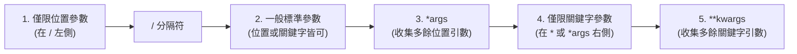

# Python 函式（Function）呼叫與引數傳遞完全指南

歡迎來到 Python 函式呼叫的專題教學！在 Python 中，定義函式只是第一步，**如何正確、靈活且優雅地呼叫函式**，是寫出高品質、好維護程式碼的核心基本功。

本講義專門針對「函式呼叫的方式」進行深度解析，帶你搞懂**位置引數**、**關鍵字引數**，以及常讓新手困惑的特殊符號：`*`、`**` 與 `/`。

---

## 目錄
1. [觀念釐清：參數（Parameter） vs. 引數（Argument）](#1-觀念釐清參數parameter-vs-引數argument)
2. [基礎呼叫方式](#2-基礎呼叫方式)
   - [2.1 位置引數（Positional Arguments）](#21-位置引數positional-arguments)
   - [2.2 關鍵字引數（Keyword Arguments）](#22-關鍵字引數keyword-arguments)
   - [2.3 混用規則：位置引數必須在關鍵字引數之前](#23-混用規則位置引數必須在關鍵字引數之前)
   - [2.4 預設參數值（Default Values）](#24-預設參數值default-values)
3. [特殊控制符號：/ 與 *（限定傳遞方式）](#3-特殊控制符號--與-限定傳遞方式)
   - [3.1 符號 `/`：僅限位置引數（Positional-Only）](#31-符號--僅限位置引數positional-only)
   - [3.2 符號 `*`：僅限關鍵字引數（Keyword-Only）](#32-符號--僅限關鍵字引數keyword-only)
4. [不定長度引數與解包：*args 與 **kwargs](#4-不定長度引數與解包args-與-kwargs)
   - [4.1 符號 `*` 的雙重角色：打包與解包](#41-符號--的雙重角色打包與解包)
   - [4.2 符號 `**` 的雙重角色：打包與解包](#42-符號--的雙重角色打包與解包)
5. [全景統整：參數順序規則與速查表](#5-全景統整參數順序規則與速查表)
6. [常見錯誤與除錯指引（Debug Guide）](#6-常見錯誤與除錯指引debug-guide)
7. [隨堂動手練習與解答](#7-隨堂動手練習與解答)

---

## 1. 觀念釐清：參數（Parameter） vs. 引數（Argument）

在深入討論前，先區分這兩個常被混用的名詞：

| 名稱 | 英文 | 出現位置 | 角色說明 | 生活比喻 |
| :--- | :--- | :--- | :--- | :--- |
| **參數** | Parameter (形參) | **定義函式時** | 宣告函式需要接收什麼變數 | 點餐單上的「餐點欄位」 |
| **引數** | Argument (實參) | **呼叫函式時** | 實際傳入函式運算的值或物件 | 你實際勾選的「牛肉麵」 |

```python
# 這裡的 name 和 age 是「參數 (Parameters)」
def introduce(name, age):
    print(f"大家好，我是 {name}，今年 {age} 歲。")

# 這裡傳入的 "小明" 和 18 是「引數 (Arguments)」
introduce("小明", 18)
```

---

## 2. 基礎呼叫方式

### 2.1 位置引數（Positional Arguments）

最傳統也最常見的呼叫方式。傳入的值會**按照位置順序**依序指派給對應的參數。

```python
def make_coffee(size, flavor):
    print(f"製作一杯「{size}」的「{flavor}」咖啡")

# 依照順序傳入：第 1 個值給 size，第 2 個值給 flavor
make_coffee("大杯", "拿鐵")   # 輸出：製作一杯「大杯」的「拿鐵」咖啡
```

> [!WARNING]
> **位置引數的盲點：順序搞錯，語義完全相反！**
> ```python
> # 順序傳反了，Python 不會報錯，但邏輯完全錯誤
> make_coffee("拿鐵", "大杯")   # 輸出：製作一杯「拿鐵」的「大杯」咖啡 (不合常理)
> ```

---

### 2.2 關鍵字引數（Keyword Arguments）

呼叫函式時，明確以 `參數名稱 = 值` 的形式傳遞。

```python
def make_coffee(size, flavor):
    print(f"製作一杯「{size}」的「{flavor}」咖啡")

# 明確指定參數名稱
make_coffee(size="中杯", flavor="美式")

# 優勢：順序可以自由對調，程式依然完全正確！
make_coffee(flavor="美式", size="中杯")
```

#### 關鍵字引數的兩大好處：
1. **防止傳錯位置**：參數數量多時，不用辛苦背誦哪一個欄位排在第幾個。
2. **自我解釋力（Self-documenting）**：閱讀程式碼的人一眼就能看出每個引數的意圖。

---

### 2.3 混用規則：位置引數必須在關鍵字引數之前

你可以同時使用「位置引數」與「關鍵字引數」，但必須嚴格遵守以下規則：

> [!IMPORTANT]
> **核心鐵律**：所有的**位置引數**必須寫在**關鍵字引數**的**左邊（前面）**！

```python
def student_info(name, school, grade):
    print(f"{school} {grade}年級 - {name}")

# 正確：前面先傳位置引數，後面接關鍵字引數
student_info("小華", grade=3, school="第一中學")

# 錯誤：關鍵字引數後面又出現位置引數！
# student_info(name="小華", "第一中學", grade=3)
# 語法錯誤：SyntaxError: positional argument follows keyword argument
```

---

### 2.4 預設參數值（Default Values）

在定義函式時，可以給參數設定預設值。呼叫時如果沒有提供該引數，就會自動使用預設值：

```python
def send_email(to, title, urgent=False):
    status = "【緊急】" if urgent else "【一般】"
    print(f"發送至 {to} | {status} 主旨：{title}")

# 不傳 urgent，使用預設值 False
send_email("boss@example.com", "本週進度報告")

# 透過關鍵字覆蓋預設值
send_email("boss@example.com", "伺服器異常", urgent=True)
```

---

## 3. 特殊控制符號：`/` 與 `*`（限定傳遞方式）

在 Python 3.8 之後，函式定義中加入了強大的引數限制語法：**`/`** 與 **`*`**。它們就像道路上的標誌，用來強制規範呼叫者「只能用哪種方式」傳遞引數。

```
def func(僅限位置參數, /, 位置或關鍵字皆可, *, 僅限關鍵字參數):
                      ^                  ^
                     斜線               星號
```

---

### 3.1 符號 `/`：僅限位置引數（Positional-Only）

如果在參數列表當中放入 `/`，代表**出現在 `/` 左邊的所有參數，呼叫時「只能」使用位置引數，絕對不能寫出參數名稱！**

#### 語法示範：
```python
def divide(a, b, /):
    return a / b

# 正確呼叫：純位置引數
result = divide(10, 2)
print(result)  # 5.0

# 錯誤呼叫：寫了引數名稱
# divide(a=10, b=2)
# 拋出例外：TypeError: divide() got some positional-only arguments passed as keyword arguments: 'a, b'
```

#### 混合使用場景：
```python
def register(user_id, /, name, email="none"):
    # user_id 只能用位置引數
    # name 與 email 可以用位置引數，也可以用關鍵字引數
    print(f"ID: {user_id}, Name: {name}, Email: {email}")

register(101, "Alice")                   # 正確
register(101, name="Alice")              # 正確
register(101, "Alice", email="a@ex.com") # 正確

# register(user_id=101, name="Alice")    # 錯誤！user_id 在 / 左側，不可寫出名稱
```

#### 為什麼需要 `/`？
1. **隱藏內部變數命名**：函式作者未來如果想要將 `user_id` 改名為 `uid`，外部呼叫者的程式碼完全不會損壞。
2. **符合直覺**：像 Python 內建的 `len([1, 2, 3])` 或 `abs(-5)`，你從來不需要寫 `len(obj=[1, 2, 3])`，強制使用位置傳入能簡化使用心智負擔。

---

### 3.2 符號 `*`：僅限關鍵字引數（Keyword-Only）

如果參數列表中出現單獨一個 `*`，代表**出現在 `*` 右邊的所有參數，呼叫時「必須」使用關鍵字名稱指定，不能只給值！**

#### 語法示範：
```python
def query_db(query_sql, *, limit=100, timeout=30):
    print(f"執行：{query_sql} (限制筆數: {limit}, 超時: {timeout}s)")

# 正確呼叫：* 右邊的參數必須具名傳遞
query_db("SELECT * FROM users", limit=50)
query_db("SELECT * FROM orders", timeout=10, limit=20)

# 錯誤呼叫：嘗試以位置引數傳入 limit
# query_db("SELECT * FROM users", 50)
# 拋出例外：TypeError: query_db() takes 1 positional argument but 2 were given
```

#### 為什麼需要單獨的 `*`？
> [!TIP]
> **提高安全性與可讀性**：
> 假設有一個函式 `set_temperature(degree, celsius=True)`：
> 如果寫成 `set_temperature(100, False)`，光看程式碼很難一眼看出 `False` 代表什麼意思。
> 若改為 `def set_temperature(degree, *, celsius=True)`，呼叫者就必須寫 `set_temperature(100, celsius=False)`，程式意圖極度清楚，避免嚴重誤判！

---

## 4. 不定長度引數與解包：`*args` 與 `**kwargs`

在實際開發中，我們常常不知道呼叫者會傳入幾個值。這時 `*` 與 `**` 就派上用場了！

### 4.1 符號 `*` 的雙重角色：打包與解包

#### 角色 A：函式定義時使用 `*`（打包為 Tuple）
當參數名稱前面加上 `*`（慣例命名為 `*args`），代表它可以接收**任意數量的位置引數**，並在函式內部打包成一個 `tuple`（元組）。

```python
def calculate_sum(*numbers):
    print("內部型態：", type(numbers))  # <class 'tuple'>
    total = 0
    for n in numbers:
        total += n
    return total

print(calculate_sum(1, 2))          # 3
print(calculate_sum(10, 20, 30, 40)) # 100
print(calculate_sum())               # 0
```

#### 角色 B：函式呼叫時使用 `*`（解包 List / Tuple）
如果你手邊已經有一個清單或元組，想將裡面的元素拆開成多個獨立位置引數傳進函式，可以在呼叫時於變數前加上 `*`：

```python
def book_flight(origin, destination, date):
    print(f"預訂機票：{origin} -> {destination}，日期：{date}")

flight_info = ["台北 (TPE)", "東京 (NRT)", "2026-12-25"]

# 一般傳法：一個一個拿出來（繁瑣）
# book_flight(flight_info[0], flight_info[1], flight_info[2])

# 使用 * 解包（優雅俐落）：
book_flight(*flight_info)
```

---

### 4.2 符號 `**` 的雙重角色：打包與解包

#### 角色 A：函式定義時使用 `**`（打包為 Dict）
當參數名稱前面加上 `**`（慣例命名為 `**kwargs`，全名 Keyword Arguments），代表它可以接收**任意數量的關鍵字引數**，並在函式內部打包成一個 `dict`（字典）。

```python
def print_user_profile(user_id, **extra_info):
    print(f"使用者 ID: {user_id}")
    print("額外資訊（字典形式）：", extra_info)
    for key, value in extra_info.items():
        print(f" - {key}: {value}")

print_user_profile(
    9527,
    name="周星星",
    job="臥底警員",
    hobbies=["武術", "搞笑"]
)
```

#### 角色 B：函式呼叫時使用 `**`（解包 Dict）
如果你手邊有一個現成的字典，想將裡面的鍵值對（key-value）直接當作關鍵字引數傳入函式，可以在呼叫時於字典前加上 `**`：

```python
def configure_server(host, port, debug=False):
    print(f"伺服器啟動於 http://{host}:{port} (除錯模式: {debug})")

settings = {
    "host": "127.0.0.1",
    "port": 8080,
    "debug": True
}

# 使用 ** 解包字典，自動對應 host, port, debug 參數
configure_server(**settings)
```

---

## 5. 全景統整：參數順序規則與速查表

當你想要在同一個函式中結合這些功能時，參數的排列順序必須嚴格按照以下標準：

### 標準參數排列公式
```python
def complete_func(pos_only, /, standard, *args, kw_only, **kwargs):
    pass
```



### 符號意義速查表

| 符號 | 在「函式定義」中的意義 | 在「函式呼叫」中的意義 | 違反時的常見錯誤 |
| :---: | :--- | :--- | :--- |
| **`/`** | 分隔線：**左邊**的參數**僅限位置引數** | 不出現在呼叫中 | `TypeError: got some positional-only arguments passed as keyword arguments` |
| **`*`** (單獨) | 分隔線：**右邊**的參數**僅限關鍵字引數** | 不出現在呼叫中 | `TypeError: takes X positional arguments but Y were given` |
| **`*args`** | 將多餘的位置引數打包成 **Tuple** | 將 List/Tuple 解包（拆散）成獨立位置引數 | `TypeError: takes X arguments but Y were given` |
| **`**kwargs`** | 將多餘的關鍵字引數打包成 **Dict** | 將 Dict 解包（拆散）成關鍵字引數傳遞 | `TypeError: got an unexpected keyword argument` |

---

## 6. 常見錯誤與除錯指引（Debug Guide）

以下是初學者在呼叫函式時最常遇到的錯誤類型與解法：

### 錯誤 1：位置引數放在關鍵字引數後面
```python
def add(a, b):
    return a + b

# 錯誤範例：
add(a=1, 2)
```
- **錯誤訊息**：`SyntaxError: positional argument follows keyword argument`
- **修正方式**：位置引數一律寫在最前面，改為 `add(1, b=2)` 或 `add(1, 2)`。

---

### 錯誤 2：關鍵字引數傳給了「僅限位置」參數
```python
def get_discount(price, rate, /):
    return price * rate

# 錯誤範例：
get_discount(price=1000, rate=0.8)
```
- **錯誤訊息**：`TypeError: get_discount() got some positional-only arguments passed as keyword arguments: 'price, rate'`
- **修正方式**：因為在 `/` 左側，不能指定名稱，改為純位置呼叫 `get_discount(1000, 0.8)`。

---

### 錯誤 3：沒有以關鍵字傳遞「僅限關鍵字」參數
```python
def export_data(filepath, *, format="csv"):
    print(f"輸出至 {filepath}，格式為 {format}")

# 錯誤範例：
export_data("report.csv", "json")
```
- **錯誤訊息**：`TypeError: export_data() takes 1 positional argument but 2 were given`
- **修正方式**：在 `*` 後面的參數必須標註名稱，改為 `export_data("report.csv", format="json")`。

---

### 錯誤 4：同一個參數被重複賦值
```python
def greet(name, msg="Hello"):
    print(f"{msg}, {name}!")

# 錯誤範例：第一個位置引數已經把 "Alice" 給了 name，後面又寫 name="Bob"
greet("Alice", name="Bob")
```
- **錯誤訊息**：`TypeError: greet() got multiple values for argument 'name'`
- **修正方式**：確認引數傳遞不要重複指向同一變數。

---

## 7. 隨堂動手練習與解答

請試著閱讀以下程式題目，並寫出正確的呼叫方式或找出問題所在：

### 題目 1：名片印製機（位置與關鍵字混用）
現有函式定義如下：
```python
def print_card(name, title="專員", company="科技公司"):
    print(f"[{company}] {title} - {name}")
```
**任務**：
1. 請以「純位置引數」印出一張「張三、經理、未來科技」的名片。
2. 請以「關鍵字引數」只修改公司為「星際創新」，保留預設職稱「專員」，名字為「李四」。

<details>
<summary>點擊展開參考解答</summary>

```python
# 1. 純位置引數
print_card("張三", "經理", "未來科技")

# 2. 關鍵字引數
print_card(name="李四", company="星際創新")
```
</details>

---

### 題目 2：神秘符號辨識（`/` 與 `*`）
觀察以下函式：
```python
def order_food(item, count, /, *, discount=1.0, note=""):
    print(f"品項：{item} x {count}，折扣：{discount}，備註：{note}")
```
**任務**：
判斷下列哪幾種呼叫方式是**合法正確**的？哪幾種會**引發錯誤**？
- (A) `order_food("漢堡", 2)`
- (B) `order_food(item="漢堡", count=2)`
- (C) `order_food("薯條", 1, 0.9)`
- (D) `order_food("披薩", 3, discount=0.8, note="不要洋蔥")`

<details>
<summary>點擊展開參考解答</summary>

- **(A) 合法**：`item` 和 `count` 在 `/` 左側用位置傳入；`discount` 與 `note` 具備預設值可省略。
- **(B) 錯誤**：`item` 與 `count` 在 `/` 左側，禁止使用關鍵字引數（拋出 `TypeError`）。
- **(C) 錯誤**：`0.9` 試圖用位置引數傳入，但它在 `*` 右側，必須明確寫出 `discount=0.9`（拋出 `TypeError`）。
- **(D) 合法**：前兩項用位置引數，後兩項在 `*` 右側明確使用關鍵字引數。
</details>

---

### 題目 3：解包練習（`*` 與 `**`）
現有一筆客戶訂單資料：
```python
items = ["筆電", "滑鼠", "鍵盤"]
delivery_info = {"address": "台北市信義區", "recipient": "王小明"}

def checkout(main_item, *extra_items, address="自取", recipient="無名氏"):
    print(f"主要商品：{main_item}")
    print(f"加購商品：{extra_items}")
    print(f"寄送地址：{address}，收件人：{recipient}")
```
**任務**：
請使用 `*` 與 `**` 解包語法，將 `items` 與 `delivery_info` 的內容傳給 `checkout` 函式。

<details>
<summary>點擊展開參考解答</summary>

```python
# 解法：
checkout(*items, **delivery_info)

# 解說：
# *items 會把清單拆開：
#   - 第一個 "筆電" 傳給 main_item
#   - 剩餘的 "滑鼠", "鍵盤" 被 *extra_items 接收為 ('滑鼠', '鍵盤')
# **delivery_info 會把字典拆開傳入 address 與 recipient
```
</details>
